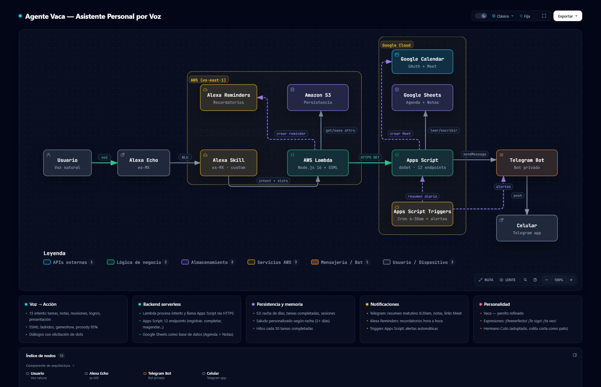

# Vaca - Asistente Personal por Voz

Asistente personal activado por voz a través de Amazon Alexa, con backend serverless en AWS Lambda y Google Apps Script. Maneja tareas, notas, reuniones y recordatorios usando solo la voz, con notificaciones automáticas por Telegram.

**Idioma:** Español (es-MX) | **Zona horaria:** America/Lima

## Arquitectura

[](https://stephbites.github.io/agente-vaca/architecture/agente-vaca.html)

> Clic en la imagen para abrir el diagrama interactivo (dark/light mode, zoom, animaciones)

### Componentes

| Componente | Tecnología | Función |
|---|---|---|
| Alexa Skill | ASK SDK, es-MX | 15 intents con NLU, modelo de interacción |
| AWS Lambda | Node.js 16, ask-sdk | Procesamiento de intents, SSML, persistencia |
| Amazon S3 | Persistence Adapter | Racha de días, contadores, sesiones |
| Google Apps Script | doGet, 12 endpoints | API REST para CRUD de tareas, notas, reuniones |
| Google Sheets | 2 hojas | Base de datos: Agenda (ID/Fecha/Hora/Tarea/Estado) y Notas (ID/Fecha/Hora/Nota) |
| Google Calendar | OAuth + Meet | Crear eventos con link de videoconferencia |
| Telegram Bot | sendMessage API | Notificaciones: resumen diario, notas, links Meet |
| Alexa Reminders | Reminders API | Recordatorios hora a hora del día |
| n8n (opcional) | Workflows JSON | Automatizaciones: alertas de tareas atrasadas, resumen semanal |

## Intents (comandos de voz)

| Intent | Ejemplo de voz | Qué hace |
|---|---|---|
| RegistrarTarea | "Registra estudiar SQL a las 3" | Crea tarea en Google Sheets con fecha y hora |
| ConsultarPendientes | "Qué tengo pendiente" | Lee tareas del día desde Sheets |
| ProgramarDia | "Programa mi día" | Lista todas las tareas de hoy con horarios |
| CompletarTarea | "Completé estudiar SQL" | Marca como hecha, actualiza contadores en S3 |
| CancelarTarea | "Elimina la tarea de correr" | Borra la tarea de Sheets |
| ReagendarTarea | "Mueve estudiar a mañana" | Cambia la fecha de la tarea |
| CambiarHora | "Cambia estudiar a las 5" | Modifica la hora de una tarea |
| GuardarNota | "Toma nota revisar documentos" | Guarda nota en Sheets + notifica por Telegram |
| LeerNotas | "Lee mis notas" | Lee las notas del día |
| CrearReunion | "Crea reunión con el equipo a las 4" | Evento en Calendar con link Meet + Telegram |
| LogrosDelDia | "Cómo voy hoy" | Porcentaje de avance del día con feedback |
| QuienEres | "Quién eres" | Presentación del asistente |
| QuienEsCuto | "Quién es Cuto" | Presenta a su hermano Cuto |

## Personalidad

El asistente es un perrito refinado y amigable que responde con personalidad:

- **Ladridos SSML** al iniciar cada sesión (`soundbank://soundlibrary/animals/amzn_sfx_dog_small_bark_2x_01`)
- **Expresiones recurrentes:** "¡Peeeerfecto!", "¡Te sigo!", "¡Ya veo!", "¡Moveré mi colita de la emoción!"
- **Racha de días:** Saludo personalizado cuando llevas 3+ días consecutivos
- **Hitos:** Celebración cada 50 tareas completadas
- **Humor:** "Dile a Cuto que es adoptado", "Si me porto bien, ¿me das una galletita?"
- **Hermano Cuto:** Perrito adoptado con la colita corta como pato

## Persistencia (S3)

El skill recuerda entre sesiones usando Amazon S3:

```javascript
// Datos que persisten
{
  racha: 5,                   // Días consecutivos de uso
  ultimaFecha: "2026-11-10",  // Última fecha de interacción
  tareasCompletadasTotal: 127, // Total histórico
  notasTotal: 34,             // Total de notas guardadas
  sesiones: 89                // Veces que se ha abierto el skill
}
```

El saludo cambia según la racha:
- **Primera vez:** "¡Hola! Soy Vaca, tu asistente personal."
- **Racha 3+ días:** "Llevamos 5 días seguidos juntos. ¡Moveré mi colita de la emoción!"
- **Normal:** "Vaca al servicio. ¿Qué hacemos?"

## Google Apps Script - API REST

12 endpoints vía `doGet` con parámetro `action`:

| Endpoint | Parámetros | Función |
|---|---|---|
| `registrar` | fecha, hora, tarea | Crea tarea en hoja Agenda |
| `completar` | texto, fecha | Marca tarea como "Hecho" |
| `reagendar` | texto, fecha, nueva_fecha | Mueve tarea a otra fecha |
| `cambiar_hora` | texto, fecha, nueva_hora | Cambia hora de la tarea |
| `borrar` | texto, fecha | Elimina fila de la tarea |
| `nota` | nota, fecha, hora | Guarda nota en hoja Notas + Telegram |
| `leer_notas` | fecha | Lee notas del día |
| `resumen` | fecha | Cuenta completadas vs pendientes |
| `logros` | fecha | Calcula porcentaje de avance |
| `reunion` | titulo, fecha, hora | Crea evento Calendar + Meet + Telegram |
| `telegram` | mensaje | Envía mensaje directo a Telegram |
| `bulk` | (sin params) | Lee toda la hoja Agenda como JSON |

## Notificaciones (Telegram)

Un bot de Telegram envía notificaciones automáticas:

- **Notas en tiempo real:** Cada nota guardada por voz llega al celular
- **Links de Meet:** Al crear reunión, el link llega por Telegram
- **Resumen matutino (6:30am):** Trigger automático con tareas del día
- **Alertas de tareas atrasadas (9am):** Tareas con 2+ días de atraso
- **Resumen semanal (domingo 8pm):** Completadas vs pendientes, mejor día, porcentaje

## Automatizaciones (n8n)

La carpeta `n8n/` contiene workflows importables:

- **`resumen-semanal.json`** — Cada domingo 8pm: lee agenda, calcula stats, envía resumen por Telegram
- **`alerta-tareas-atrasadas.json`** — Cada día 9am: detecta tareas con 2+ días de atraso, envía alerta

Alternativamente se pueden implementar como Google Apps Script Triggers (sin n8n).

## Estructura del repositorio

```
agente-vaca/
├── alexa/
│   ├── lambda/
│   │   ├── index.js          # Handler principal: 15 intents + SSML + S3
│   │   └── package.json      # ask-sdk-core + s3-persistence-adapter
│   └── skill-package/
│       └── interactionModels/
│           └── custom/
│               └── es-MX.json # Modelo de interacción: intents, slots, samples
├── apps-script/
│   ├── Codigo.js              # API REST: 12 endpoints + Telegram + Calendar
│   └── appsscript.json        # Configuración Apps Script
├── n8n/
│   ├── resumen-semanal.json           # Workflow: resumen domingo 8pm
│   └── alerta-tareas-atrasadas.json   # Workflow: alertas diarias 9am
├── architecture/
│   └── agente-vaca.html       # Diagrama interactivo del ecosistema
└── README.md
```

## Cómo replicarlo

### Prerequisitos

- Cuenta Amazon Developer (gratis)
- Cuenta AWS con acceso a Lambda y S3
- Cuenta Google con Apps Script y Calendar
- Bot de Telegram (crear con @BotFather)
- (Opcional) Instancia de n8n

### Paso 1: Google Sheets

1. Crear un Google Sheet con dos hojas:
   - **Agenda:** columnas `ID | Fecha | Hora | Tarea | Estado | Alertar`
   - **Notas:** columnas `ID | Fecha | Hora | Nota`

### Paso 2: Google Apps Script

1. Abrir Apps Script desde el Sheet (Extensiones > Apps Script)
2. Pegar el contenido de `apps-script/Codigo.js`
3. Reemplazar `YOUR_TELEGRAM_BOT_TOKEN` y `YOUR_TELEGRAM_CHAT_ID` con tus datos
4. Implementar como Web App: Ejecutar como "Yo" + Acceso "Cualquiera"
5. Copiar la URL del deploy

### Paso 3: Alexa Skill

1. Crear skill en [developer.amazon.com](https://developer.amazon.com/alexa/console/ask)
   - Tipo: Custom, Hosting: Alexa-Hosted (Node.js)
   - Idioma: Spanish (MX)
   - Invocation: el nombre que prefieras (ej. "mi asistente")
2. En Build > Interaction Model > JSON Editor: pegar `es-MX.json`
3. En Code: reemplazar `index.js` y `package.json` con los de `alexa/lambda/`
4. Reemplazar `YOUR_APPS_SCRIPT_URL` con la URL del paso 2
5. Build Model + Deploy

### Paso 4: Telegram Bot

1. Hablar con [@BotFather](https://t.me/BotFather) en Telegram
2. `/newbot` > elegir nombre > copiar el token
3. Enviar un mensaje al bot y obtener tu `chat_id` con: `https://api.telegram.org/bot<TOKEN>/getUpdates`

### Paso 5: n8n (opcional)

1. Importar los JSON de `n8n/` en tu instancia de n8n
2. Reemplazar las URLs y tokens con tus datos
3. Activar los workflows

## Decisiones técnicas y por qué

| Decisión | Por qué |
|---|---|
| **Google Sheets como DB** | Cero costo, editable a mano, visible en celular, suficiente para uso personal |
| **Apps Script como API** | Gratis, acceso nativo a Sheets/Calendar/Gmail, deploy inmediato |
| **S3 para persistencia Alexa** | Único mecanismo soportado por Alexa Hosted Skills para estado entre sesiones |
| **Telegram para notificaciones** | API simple, push instantáneo al celular, soporta HTML y links |
| **SSML con personalidad** | Diferenciador: no es solo un CRUD por voz, tiene carácter y engagement |
| **n8n para automatizaciones** | Visual, importable, no requiere escribir cron jobs manuales |
| **Modelo de interacción es-MX** | Skill pensado para uso real en español latinoamericano |

## Tecnologías

`Alexa Skills Kit` `AWS Lambda` `Amazon S3` `Node.js` `Google Apps Script`
`Google Sheets` `Google Calendar API` `Telegram Bot API` `SSML` `n8n` `OAuth 2.0`

---

Proyecto personal de portafolio.
